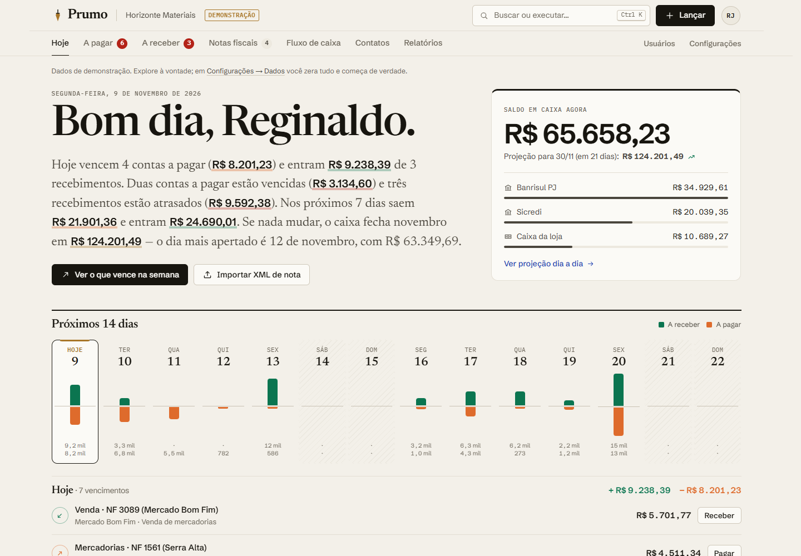
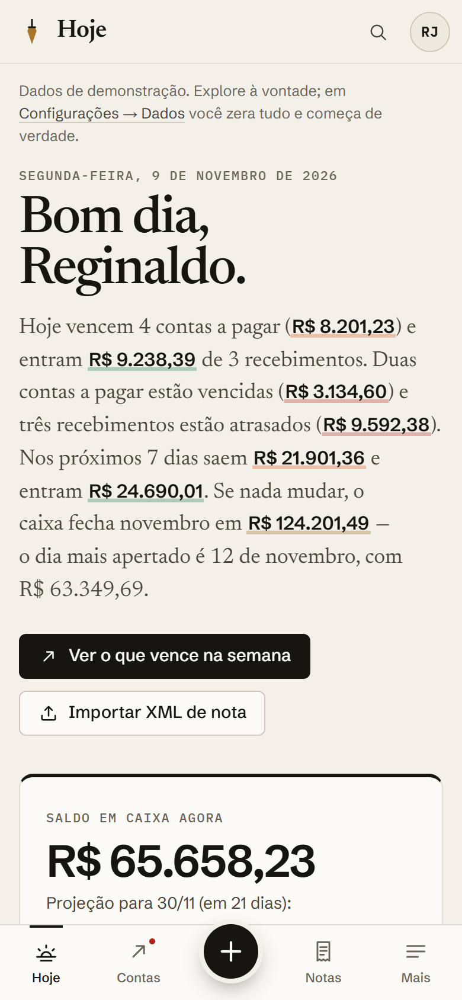
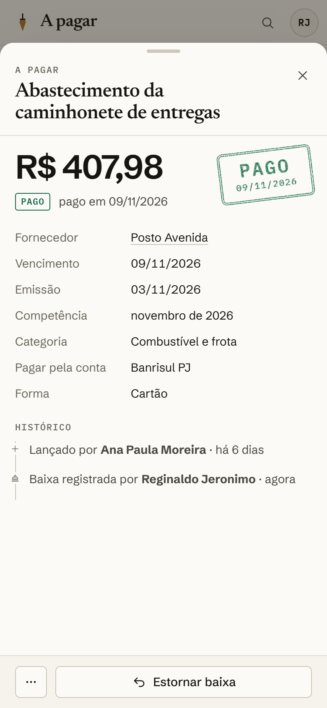
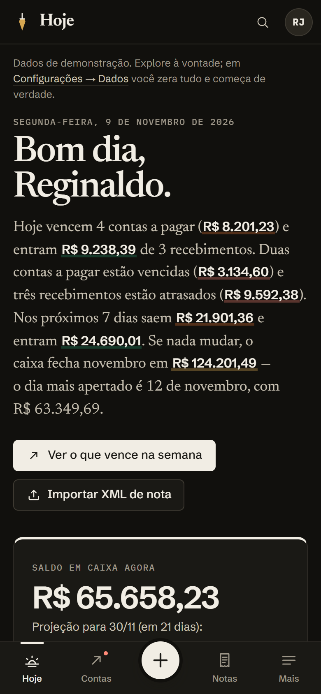
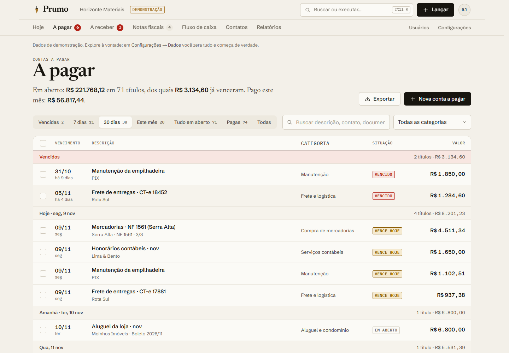
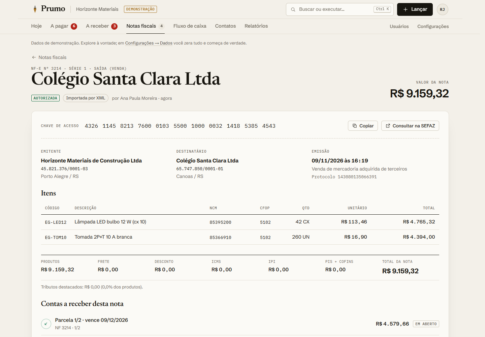
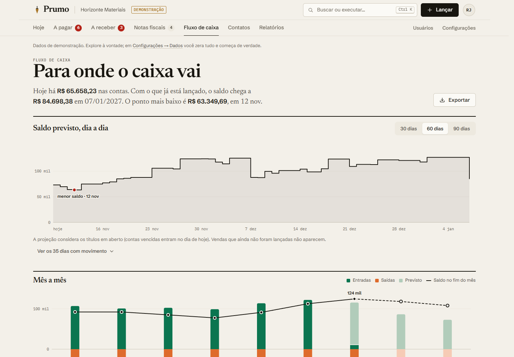
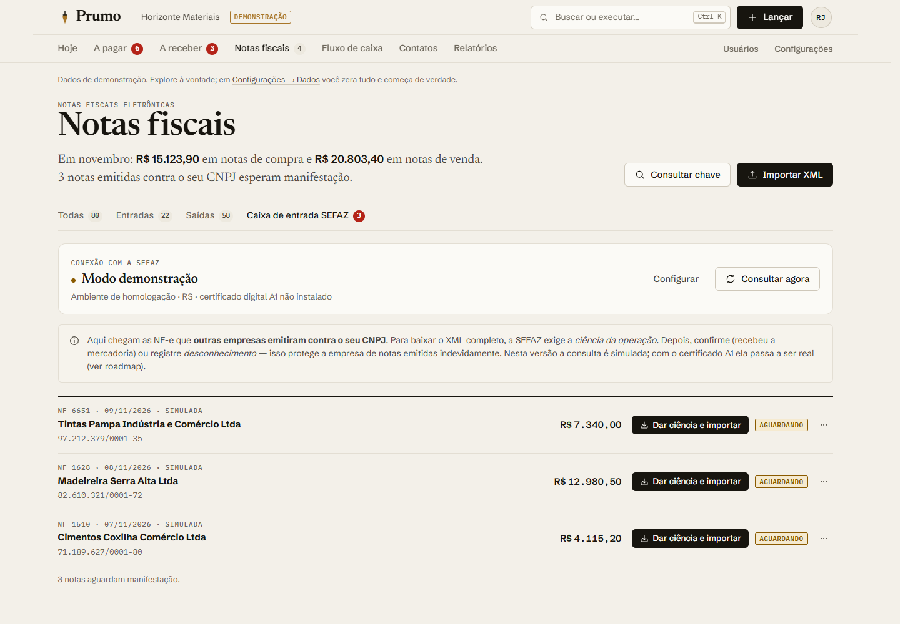
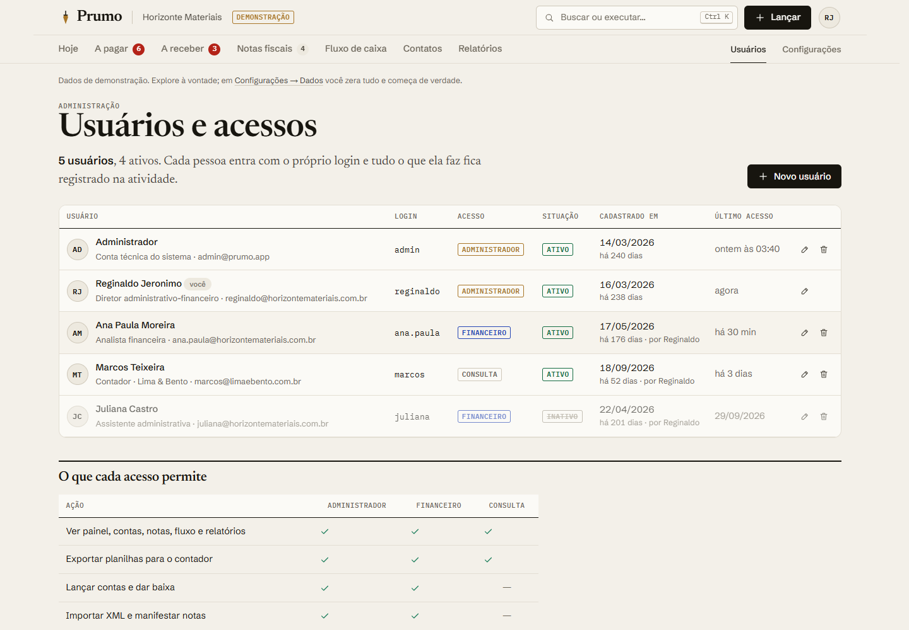
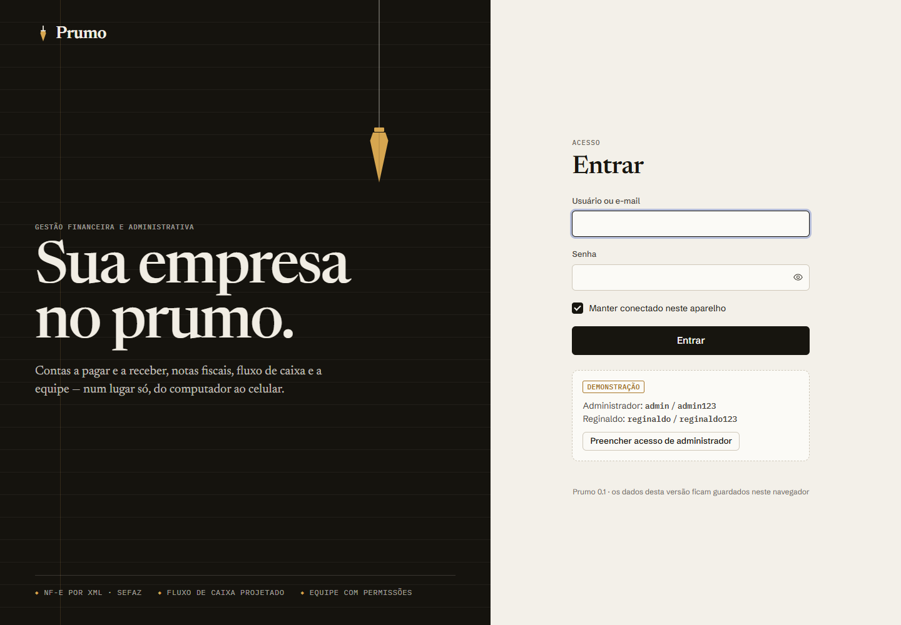

<div align="center">


# Prumo

**Sua empresa no prumo.**
Gestão financeira e administrativa para pequenas e médias empresas: contas a pagar e a receber, notas fiscais (XML e SEFAZ), fluxo de caixa e a equipe — do computador ao celular.

**[Abrir a demonstração](https://eduardochimchek.github.io/prumo/)** · usuário `admin` / senha `admin123`

</div>



---

## Sumário

- [O que é](#o-que-é)
- [O que a V1 já faz](#o-que-a-v1-já-faz)
- [Telas](#telas)
- [Como acessar](#como-acessar)
- [Rodar no computador (desenvolvimento)](#rodar-no-computador-desenvolvimento)
- [Arquitetura](#arquitetura)
- [Design: “Papel & Tinta”](#design-papel--tinta)
- [SEFAZ e notas fiscais](#sefaz-e-notas-fiscais)
- [Segurança e limites da V1](#segurança-e-limites-da-v1)
- [Roadmap](#roadmap)
- [Por que “Prumo”](#por-que-prumo)
- [Documentação](#documentação)

## O que é

O Prumo é um sistema financeiro-administrativo pensado para quem toca o dia a dia de uma empresa: o financeiro que paga boletos, confere notas de fornecedores, cobra clientes e precisa saber **hoje** quanto vai ter no caixa daqui a duas semanas.

A proposta é fugir do ERP “das antigas” — menus em árvore, telas cinzas, dez cliques para dar baixa num boleto — e entregar uma ferramenta que se lê como um jornal: a primeira tela é uma **manchete escrita a partir dos seus números** (“Hoje vencem 4 contas a pagar… o dia mais apertado é 12 de novembro”), e cada ação comum está a um toque.

Idealizado por **Reginaldo Jeronimo**, profissional do financeiro administrativo. Esta é a **V1**: completa para demonstrar e validar o produto, com os dados guardados no próprio navegador (veja [limites](#segurança-e-limites-da-v1)).

## O que a V1 já faz

**Painel “Hoje”**
- Manchete automática: o que vence hoje, o que atrasou, quanto sai e entra na semana e como o caixa fecha o mês.
- Saldo em caixa por conta bancária, com a projeção para o fim do mês.
- Agenda dos próximos 14 dias (entradas sobem, saídas descem), lista do dia com baixa rápida.
- “Para resolver”: contas vencidas, notas que ainda não viraram contas, notas aguardando manifestação na SEFAZ.
- Atividade da equipe (quem fez o quê) e para onde vai o dinheiro do mês.

**Contas a pagar e a receber**
- Lançamento com **leitura do boleto**: cole a linha digitável e o Prumo preenche valor, vencimento e banco — conferindo os dígitos verificadores (inclui a regra do fator de vencimento que reiniciou em 22/02/2025).
- Parcelamento (divide o valor) ou recorrência mensal.
- Filtros (vencidas, 7 dias, 30 dias, mês, pagas), busca, categoria, **baixa em lote**, juros/desconto, estorno e **“Desfazer”**.
- Carimbo de “PAGO” no título quitado, histórico completo, parcelas irmãs, nota de origem.
- Exportação para Excel (CSV no padrão brasileiro).

**Notas fiscais (NF-e)**
- **Importação do XML** (um ou vários de uma vez): lê emitente, destinatário, itens, impostos e duplicatas; decide sozinho se é compra (você é o destinatário) ou venda (você é o emitente); cadastra o fornecedor/cliente e **gera as contas a pagar/receber pelas duplicatas**. Bloqueia nota repetida.
- **DANFE redesenhado** para leitura, com chave de acesso formatada.
- **Consulta de chave de acesso**: valida o dígito e mostra UF, mês, emitente, modelo, série e número; abre o portal da SEFAZ com a chave copiada.
- **Caixa de entrada SEFAZ** (simulada na V1): notas emitidas contra o seu CNPJ, com ciência, confirmação, desconhecimento e “operação não realizada”.
- XML de exemplo para testar.

**Fluxo de caixa e relatórios**
- Projeção do saldo **dia a dia** (30/60/90 dias) com o “dia mais apertado” destacado.
- Mês a mês: realizado × previsto e saldo no fim de cada mês, com tabela.
- **DRE gerencial** por regime de caixa ou competência (3, 6 ou 12 meses).
- Planilhas para o contador: lançamentos, notas e contatos.

**Cadastros e equipe**
- Clientes e fornecedores com **busca do CNPJ na Receita Federal** (BrasilAPI) e do CEP.
- Suporte ao **CNPJ alfanumérico** (novo formato emitido desde julho de 2026).
- **Usuários com data de cadastro**, quem cadastrou, último acesso, ativo/inativo e três níveis de acesso: Administrador, Financeiro e Consulta (ideal para o contador).
- Empresa, contas bancárias, categorias, backup/restauração e “começar de verdade” (zera os dados de demonstração).

**Experiência**
- Funciona no celular como app (**PWA**: “Adicionar à tela inicial”), com navegação própria para o polegar.
- Tema claro e escuro, busca e comandos por **Ctrl+K** (ou `/`), acessível por teclado.

## Telas

| Celular | Detalhe quitado | Tema escuro |
|---|---|---|
|  |  |  |

| Contas a pagar | Nota fiscal (DANFE redesenhado) |
|---|---|
|  |  |

| Fluxo de caixa | Caixa de entrada SEFAZ |
|---|---|
|  |  |

| Usuários e acessos | Login |
|---|---|
|  |  |

Todas as capturas ficam em [`docs/screenshots`](docs/screenshots) e são geradas com `npm run screenshots`.

## Como acessar

- **Demonstração online:** <https://eduardochimchek.github.io/prumo/>
- **No celular:** abra o link e use “Adicionar à tela inicial” (Android/Chrome) ou Compartilhar → “Adicionar à Tela de Início” (iPhone/Safari).

| Usuário | Senha | Acesso |
|---|---|---|
| `admin` | `admin123` | Administrador (conta técnica) |
| `reginaldo` | `reginaldo123` | Administrador |
| `ana.paula` | `ana123` | Financeiro |
| `marcos` | `marcos123` | Consulta (contador) |

> A base de demonstração é uma loja de materiais de construção **fictícia** em Porto Alegre/RS, com 9 meses de histórico e 2 de projeção, gerada a partir da data de hoje. Nomes, CNPJs e valores são inventados.
> Para usar de verdade: **Configurações → Dados e backup → Zerar dados**, depois cadastre empresa, contas bancárias e troque as senhas.

## Rodar no computador (desenvolvimento)

Pré-requisitos: **Node.js 22.22+** (recomendado 24) e npm.

```bash
git clone https://github.com/Eduardochimchek/prumo.git
cd prumo
npm install
npm run dev          # http://localhost:5173 (também acessível pelo celular na mesma rede)
```

| Comando | O que faz |
|---|---|
| `npm run dev` | Servidor de desenvolvimento |
| `npm run build` | Checa os tipos e gera `dist/` |
| `npm run preview` | Serve o build de produção |
| `npm test` | Testes unitários (CNPJ/CPF, boleto, chave e XML de NF-e, SHA-256, base de demonstração) |
| `npm run smoke` | Teste ponta a ponta no navegador (login, lançar, baixar, desfazer, importar XML, permissões…) |
| `npm run screenshots` | Capturas de todas as telas (desktop e celular) em `docs/screenshots` |
| `npm run verificar` | Tudo acima que importa antes de um commit |

`smoke` e `screenshots` usam o Edge ou o Chrome já instalados (via `playwright-core`, sem baixar navegador). Use `PRUMO_BROWSER=chrome` para forçar.

Todo push na branch `main` roda o CI (tipos, testes, build) e publica a demonstração no GitHub Pages (`.github/workflows/deploy.yml`).

## Arquitetura

**Stack:** React 19 + TypeScript 7 + Vite 8, React Router 8 (HashRouter), CSS próprio com tokens (sem Tailwind e sem kit de componentes), gráficos em SVG feitos à mão, fontes servidas localmente (Fontsource), Vitest + happy-dom, playwright-core para o teste ponta a ponta.

**Local-first na V1.** O banco é um objeto em memória persistido no `localStorage`, com uma interface pequena (`getDb`, `atualizar`, `useDb`). Toda escrita passa por **casos de uso** (`src/data/actions.ts`), que validam as regras e registram a atividade. Na V2, `store.ts` vira um cliente HTTP com a mesma interface — as telas não mudam.

```
src/
├── lib/            utilitários puros, sem React (testados)
│   ├── br.ts           CNPJ alfanumérico, CPF, máscaras, UFs, bancos
│   ├── boleto.ts       linha digitável / código de barras (bancário e arrecadação)
│   ├── nfe/            chave de acesso, leitor de XML, gerador de XML de exemplo
│   ├── dates.ts        datas de negócio 'YYYY-MM-DD' sem fuso
│   ├── format.ts       dinheiro em centavos, plurais, busca sem acento
│   └── sha256.ts       hash de senha (V1)
├── data/
│   ├── types.ts        modelo de domínio (futuro contrato da API)
│   ├── store.ts        persistência local + hook useDb
│   ├── actions.ts      escritas: lançar, baixar, importar nota, usuários…
│   ├── selectors.ts    leituras: status, saldos, agenda, fluxo, DRE, busca
│   └── seed.ts         base de demonstração determinística
├── services/       BrasilAPI (CNPJ/CEP) e camada SEFAZ (simulada)
├── auth/           sessão e permissões por papel
├── components/     primitivas de UI, diálogos, formulários, gráficos, paleta Ctrl+K
├── layout/         cabeçalho (desktop) e navegação inferior (celular)
├── pages/          Hoje, Contas, Notas, Fluxo, Contatos, Relatórios, Usuários, Configurações
└── styles/         tokens.css, base, components, shell, pages
```

Decisões que valem lembrar:
- **Dinheiro em centavos (inteiros)** em todo o sistema; datas de negócio como texto `YYYY-MM-DD`.
- **Status do título é calculado** (pago, vencido, vence hoje, em aberto, cancelado), nunca gravado.
- **A nota decide o sentido pelo CNPJ da empresa**: destinatário = compra (a pagar), emitente = venda (a receber).
- **Base de demonstração determinística** (gerador com semente; nada de `Math.random` nem `sort` aleatório), relativa à data de hoje.

## Design: “Papel & Tinta”

A identidade visual nasceu do próprio ofício: papel, tinta de caneta, carimbo e livro-razão — com execução moderna. Princípios:

- **Cor é informação, não decoração.** A marca é tinta sobre papel; cor só aparece quando significa algo: entrada (verde), saída (laranja), vencido (vermelho), atenção (âmbar), hoje (latão). O par entrada/saída foi **validado para daltonismo** (protanopia/deuteranopia) no claro e no escuro.
- **Tipografia editorial:** Newsreader (serifada) nos títulos e na manchete; Schibsted Grotesk na interface e nos números; IBM Plex Mono para códigos, chaves e rótulos.
- **Status como carimbo**, não como “pílula” colorida.
- **Navegação de jornal** no desktop (cabeçalho + seções) e barra inferior com botão central de lançar no celular — nada de barra lateral genérica.
- Gráficos com um eixo só, marcas finas, rótulos diretos e dica ao passar o mouse; tabela equivalente sempre disponível.
- Ícones desenhados para o produto. Fugimos de propósito dos clichês de interface gerada por IA (fonte Inter, gradiente roxo, cartões com sombra em grade, emojis).

Detalhes em [`docs/DESIGN.md`](docs/DESIGN.md).

## SEFAZ e notas fiscais

O navegador **não consegue** falar direto com a SEFAZ: os serviços exigem TLS mútuo com o **certificado digital A1** da empresa e não liberam CORS. Por isso:

- **V1 (agora):** importação de XML completa, validação de chave, abertura do portal da SEFAZ e uma **caixa de entrada simulada** que mostra exatamente como o fluxo vai funcionar.
- **V2:** um backend guarda o certificado A1 com criptografia e usa a **Distribuição DF-e** (Ambiente Nacional) para baixar automaticamente as notas emitidas contra o CNPJ e a **Recepção de Evento** para a manifestação do destinatário — ou, para chegar mais rápido ao mercado, um provedor de API fiscal.

O plano técnico completo está em [`docs/SEFAZ.md`](docs/SEFAZ.md).

## Segurança e limites da V1

Sendo direto sobre o que esta versão é:

- Os dados ficam **no navegador e no aparelho** de quem usa. Outro computador ou celular começa com a própria base. **Faça backup** em Configurações → Dados.
- O login é **local**: protege o uso no dia a dia, mas não é segurança de servidor. As senhas são guardadas com hash e sal (SHA-256 iterado), nunca em texto puro.
- As credenciais de demonstração são públicas — **troque as senhas** antes de usar com dados reais.
- A V2 resolve esses pontos com servidor, banco de dados, autenticação de verdade (Argon2id, sessão segura) e dados compartilhados entre a equipe.

## Roadmap

**V1 — protótipo funcional (esta versão)** ✓
Painel, contas a pagar/receber, boleto, NF-e por XML, caixa SEFAZ simulada, fluxo de caixa, DRE, contatos com CNPJ, usuários e permissões, PWA, tema escuro.

**V2 — uso real pela equipe**
- Backend (API Node + PostgreSQL), autenticação segura, multiempresa e dados na nuvem.
- **SEFAZ de verdade**: certificado A1, download automático das NF-e contra o CNPJ, manifestação, consulta de situação.
- **Conciliação bancária**: importar extrato OFX/CNAB e casar com os títulos; transferências entre contas.
- Guardar o XML original e gerar o PDF do DANFE.
- Cobrança: lembrete de vencimento por e-mail/WhatsApp, emissão de boleto e PIX (via banco/gateway).

**V3 — produto vendável**
- Planos e assinatura, onboarding guiado, importação de planilhas.
- NFS-e (padrão nacional), centros de custo, orçamento × realizado, aprovação de pagamentos em alçadas.
- Campos de IBS/CBS da reforma tributária nas notas e relatórios.
- Portal do contador e app nativo (se o PWA não bastar).

Visão de produto, públicos e ideias de modelo de negócio: [`docs/PRODUTO.md`](docs/PRODUTO.md).

## Por que “Prumo”

**Prumo** é o fio com um peso de latão que o pedreiro usa para conferir se a parede está reta. “Pôr no prumo” é pôr em ordem — exatamente o que um bom financeiro faz com uma empresa. É curto, fácil de falar e de lembrar, e dá um símbolo forte (o peso do prumo é a marca).

Na pesquisa feita para a V1, não encontramos software de gestão financeira com esse nome (há a Prumo Logística, de outro setor, e um escritório de BPO financeiro chamado Prumo Finanças). **Antes de vender, faça a busca de marca no INPI** (classes 9 e 42) e a checagem de domínio. Alternativas pensadas: *Lastro*, *Tino*, *Fecho*.

## Documentação

- [`CLAUDE.md`](CLAUDE.md) — guia para quem (pessoa ou IA) for evoluir o código: regras, domínio, padrões.
- [`docs/PRODUTO.md`](docs/PRODUTO.md) — visão, públicos, escopo e roadmap.
- [`docs/DESIGN.md`](docs/DESIGN.md) — design system “Papel & Tinta”.
- [`docs/SEFAZ.md`](docs/SEFAZ.md) — integração com a SEFAZ e notas fiscais.

---

© 2026 Reginaldo Jeronimo. Todos os direitos reservados — veja [`LICENSE`](LICENSE). O código está público para demonstração; isso não concede licença de uso.
